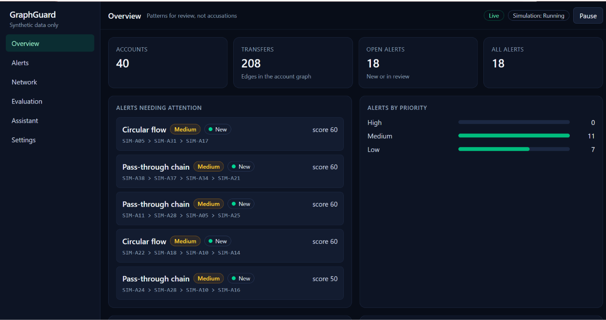
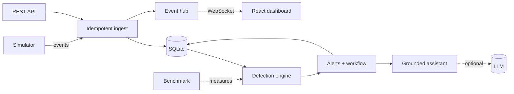

<div align="center">

# GraphGuard

**Spot suspicious money-movement patterns in a transaction graph, then investigate them with an auditable workflow.**

Educational project · **synthetic data only** · flags patterns for human review, never accuses anyone

[](https://github.com/Rehan1604/GraphGuard/actions/workflows/ci.yml)


</div>



## What it does

Banks watch transfers for shapes that deserve a second look: money passed along a chain of accounts, money going in a circle, a sudden burst of payments, one account dealing with a crowd. GraphGuard finds those shapes, scores them, and gives an analyst a place to review them.

- **Detects four patterns** with deterministic, configurable rules over an account graph: pass-through chains, circular flows, transfer bursts and many-counterparty fans.
- **Explains every alert.** Each one lists the rule that fired, the transactions that triggered it and a points breakdown. The 0-100 score is points, **not a probability**.
- **Review workflow.** New, in review, escalated or dismissed. A comment is required to escalate or dismiss, history is append-only, and duplicate alerts are merged.
- **Live stream.** A seeded simulator pushes events over a WebSocket with sequence numbers and resync after a disconnect.
- **Grounded assistant.** Explains an alert using facts from the database plus a small guidance library, with validated citations. It works with **no API key**; an LLM is optional and only sees pseudonymized ids.
- **Measures itself.** A labelled synthetic benchmark reports precision, recall and F1 with their denominators, against a naive baseline.

## Quick start

### Docker (recommended)
```bash
docker compose up --build
```
Dashboard: http://localhost:5173 · API health: http://localhost:8000/api/ready

Ports are bound to `127.0.0.1`. Open **Settings** in the dashboard and press **Start** to run the simulation. Stop with `docker compose down` (add `-v` to wipe the database).

### Without Docker (Windows PowerShell)
```powershell
# backend
cd backend
python -m venv .venv
.\.venv\Scripts\Activate.ps1
pip install -r requirements-dev.txt
python -m pytest -q
uvicorn app.main:app --reload --port 8000
```
```powershell
# frontend (second window)
cd frontend
npm ci
npm run dev
```
Open http://localhost:5173. API docs are at http://localhost:8000/docs in development (switched off in production).

No GPU, API key or internet connection is needed.

## How detection works

| Rule | Looks for | Defaults |
|---|---|---|
| Pass-through chain | Money forwarded onward again and again, like a relay | 3-6 hops, each forwards at least 80%, within 30 min per hop |
| Circular flow | Money returning to where it started | 3-5 transfers within 120 min, amounts within 80% of each other |
| Burst | Many payments touching one account quickly | 6+ transactions within 10 min |
| Fan | One account dealing with a crowd | 5+ different counterparties within 10 min |

Every threshold is a setting, adjustable from the UI or the API. Priority bands: **low** under 40, **medium** 40-69, **high** 70+.

## Results (synthetic benchmark, reproducible)

```bash
python -m app.evaluation --seed 42
python -m app.evaluation --seeds 20                      # seeds 1-20
python -m app.evaluation --seeds 20 --seed-start 101     # 20 held-out seeds
```

| | Graph engine | Naive baseline* |
|---|---|---|
| Precision (seed 42) | **52/70 = 74.3%** | 39/168 = 23.2% |
| Recall (seed 42) | 40/40 = 100% | 20/40 = 50.0% (strict) |
| F1 (seed 42) | 0.853 | 0.317 |
| Precision, 20 seeds | 66.7%-74.6% (mean 71.6%) | 22.0%-25.9% |
| Precision, 20 held-out seeds | 69.4%-75.0% (mean 72.1%) | 22.4%-25.2% |

\*Baseline: large transfer, velocity and counterparty counts, with no graph reasoning. It cannot see chains or loops at all.

**Read this before quoting the numbers.**
- The data is synthetic and written by the same author as the detectors. This shows the rules behave as designed, not how they would do on real transactions.
- **Recall is 100% by construction**, because the planted patterns were built to match the rules. Precision is the informative figure.
- Most false alarms (16 of 18 on seed 42) are benign look-alikes such as payroll, split bills and marketplace payouts. They have the same shape as real patterns, so structure alone cannot separate them. Fixing that needs a new signal, such as payment history.
- On the simulator's own stream, precision is 13/13 and recall 11/11, but that stream has no look-alikes.

## Architecture



Design notes, trade-offs and the reasoning behind each choice are in [docs/ARCHITECTURE.md](docs/ARCHITECTURE.md) and [docs/TRADEOFFS.md](docs/TRADEOFFS.md).

## Tech stack

| Layer | Tools |
|---|---|
| Backend | Python 3.12, FastAPI, Pydantic v2, SQLite, NetworkX, asyncio, WebSockets |
| Frontend | React 19, TypeScript, Vite, Tailwind CSS 4, React Flow |
| Quality | pytest, Vitest, Testing Library, oxlint, GitHub Actions |
| Delivery | Docker, Docker Compose, nginx (unprivileged) |

## Engineering highlights

- **Money is exact:** integer cents with `Decimal`, UTC timestamps.
- **Idempotent ingest:** the same transaction twice is safe; the same id with a different body returns 409.
- **Hardened service:** startup configuration checks, structured JSON logs with secret redaction, request ids, rate limiting, request size limit, security headers, CORS allow-list, docs off in production, safe error responses, non-root containers.
- **Honest testing:** 249 backend tests and 43 frontend tests, including boundary tests for every threshold, a pinned benchmark regression, and tests that check the deployment files and the documents themselves.
- **Found by its own evaluation:** one loop was reported seven times because of parallel transfers, and coincidental loops of unrelated payments were counted as cycles. Both were fixed and are covered by tests.

## API

| Area | Endpoints (under `/api`) |
|---|---|
| Health | `GET /health` (alive), `GET /ready` (database usable) |
| Data | `POST/GET /accounts`, `POST/GET /transactions`, `GET /stats`, `GET /graph` |
| Detection | `POST /detection/run`, `GET /detection/config` |
| Alerts | `POST /alerts/scan`, `GET /alerts`, `GET /alerts/{id}`, `POST /alerts/{id}/notes`, `POST /alerts/{id}/status` |
| Simulation | `GET /simulation`, `POST /simulation/start\|pause\|resume\|reset`, WebSocket `/ws/events` |
| Assistant | `GET /assistant/status`, `POST /alerts/{id}/assistant`, `GET /knowledge` |
| Evaluation | `GET /evaluation` |

## Configuration

Copy `.env.example` to `.env` (never commit it). Every variable is optional in development. In production the app refuses to start on unsafe settings, such as wildcard CORS or an AI provider without a model or key. Keys are read from the environment only and never logged.

The AI assistant is off by default. To try it, set `GRAPHGUARD_LLM_PROVIDER`, `GRAPHGUARD_LLM_MODEL` and, where needed, `GRAPHGUARD_LLM_API_KEY`. A local server such as Ollama works with `openai_compatible` and `GRAPHGUARD_LLM_BASE_URL`.

## Tests

```bash
cd backend  && python -m pytest -q            # 249 tests
cd frontend && npx vitest run && npm run build  # 43 tests, then a production build
```

## Project layout

```
backend/app/
  detection/    graph + four rules + engine
  alerts/       fingerprinting, workflow, history
  simulation/   seeded generator, ingest, background simulator
  rag/          chunking, retrieval, facts, grounding, fallback, LLM clients
  evaluation/   labelled benchmark, metrics, baseline, CLI
  config.py, middleware.py, ratelimit.py, logging_config.py   (hardening)
frontend/src/   views, components, live stream client, tests
docs/           architecture, demo script, trade-offs, interview Q&A, resume notes
```

## Limitations

- Synthetic data only; no claim about accuracy on real transactions.
- One server process: the live stream, simulator and rate limiter keep state in memory.
- SQLite is single-writer, fine for a demo but not heavy concurrent load.
- The rate limiter is per process and keyed by client address.
- No authentication or user accounts, so do not expose it publicly.
- No throughput or latency figures have been measured.

## Documents

[Architecture](docs/ARCHITECTURE.md) · [Demo script](docs/DEMO.md) · [Trade-offs](docs/TRADEOFFS.md) · [Interview Q&A](docs/INTERVIEW.md) · [Resume notes](docs/RESUME.md)

---
*GraphGuard is an educational project. Its alerts describe patterns in synthetic data and are never evidence of wrongdoing by anyone.*
