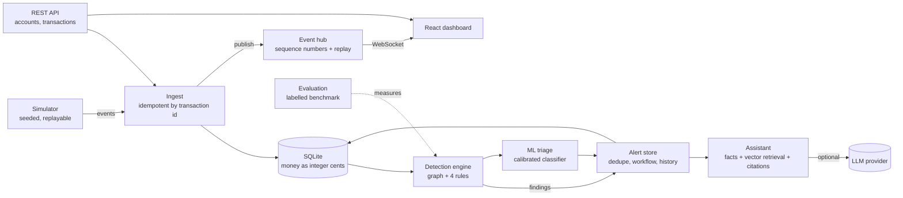

# GraphGuard architecture

GraphGuard turns a stream of money transfers into a small set of **patterns for human review**.
Data is synthetic. An alert is a pattern worth a look, never an accusation.

## The pieces, in plain words
| Piece | Job | Where |
|---|---|---|
| Ingest | Save a transfer once, even if it arrives twice | `app/simulation/ingest.py`, `app/routes.py` |
| Detection | Look at who paid whom and flag four shapes: pass-through chain, circular flow, burst, many-counterparty fan | `app/detection/` |
| Alerts | Remember findings, avoid duplicates, track review state and comments | `app/alerts/` |
| Real-time | Push new events to the browser, recover after a disconnect | `app/realtime.py` |
| ML triage | Estimate whether each rule alert is a genuine pattern or a benign look-alike, with reasons | `app/ml/` |
| Assistant (RAG) | Retrieve guidance and similar past cases by meaning from a SQLite vector store, then explain an alert from stored facts | `app/rag/` |
| Evaluation | Score the detectors against labelled synthetic cases | `app/evaluation/` |
| Hardening | Config checks, logs, limits, safe errors, headers | `app/config.py`, `middleware.py`, `ratelimit.py`, `logging_config.py` |

## Decisions worth defending
- **Rules find, a model ranks.** Rules stay the source of alerts because they are explainable and testable. A trained classifier then triages them: it cannot create alerts, only re-rank or hide ones the rules raised, and if it is absent the rules run alone.
- **Shape features only.** Amount-size features scored higher but fit the generator; held-out look-alike tests showed the model does not generalise to unseen look-alike types either. Both limits are stated in the model metadata and the UI.
- **Swappable embedder.** One interface, a neural model when available and an offline one otherwise, so tests are deterministic and nothing needs a download.
- **Scores are points, not probabilities.** Contributions are summed and capped at 100. Priority: low under 40, medium 40-69, high 70+.
- **Integer cents.** Floating point cannot represent money exactly.
- **Idempotent ingest.** Same id and same body: accepted again harmlessly (200). Same id, different body: rejected (409).
- **Alerts are append-only for history.** Escalating or dismissing requires a comment. Notes are kept apart from evidence.
- **The assistant cannot invent facts.** Facts (F#) come from the database, guidance (K#) from a library, and the model only explains. Citations are validated; accusatory wording is checked.
- **Works without an AI key.** A rule-based fallback is used and labelled as not AI.
- **One server process.** Stream, simulator and rate limiter keep state in memory.
